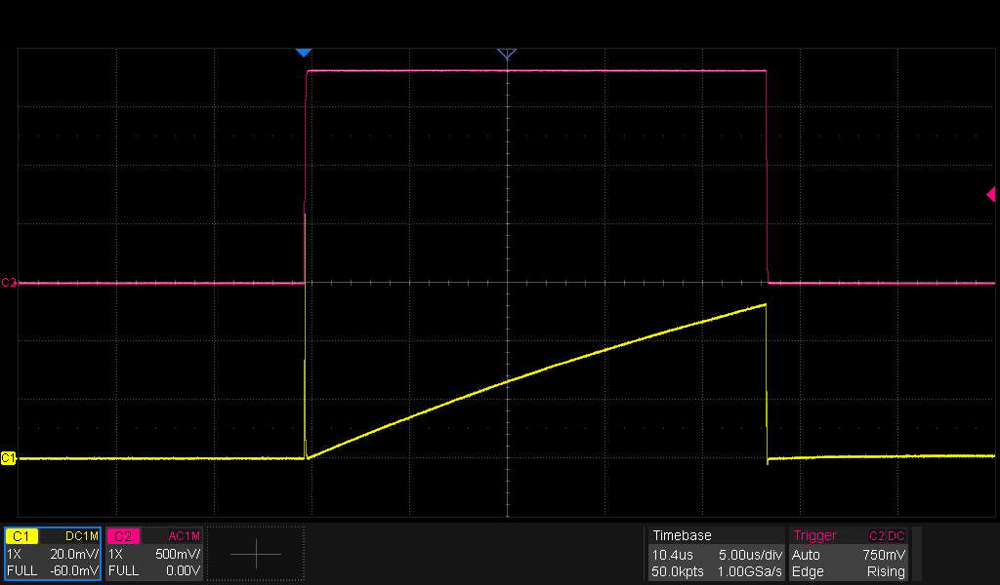
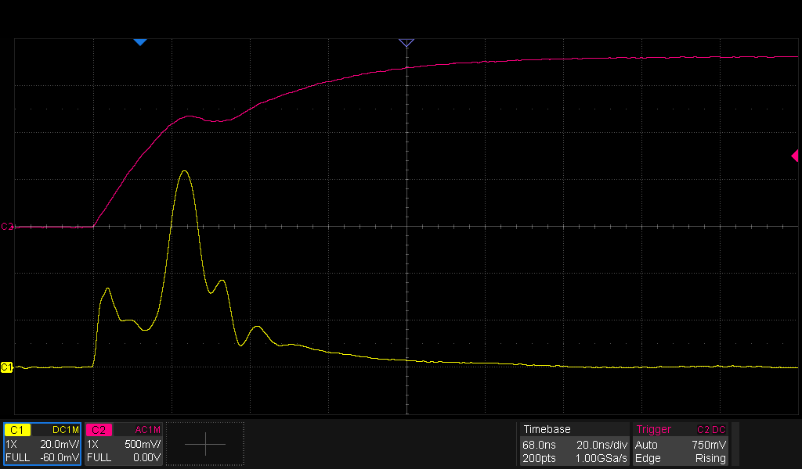
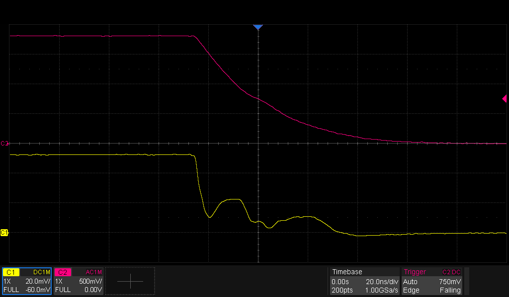

# Equipment

| Equipment | Description | Serial Number | Date of last calibration |
|-----------|-------------|---------------|--------------------------|
| Multimeter | Mastech M92 | 20011206033 | - |
| Multimeter | Fluke 8010A | 2047249 | - |
| Oscilloscope | Siglent SDS2354X HD |  SDS2HBAQ6R0257 | TBD |
| Power Supply | Siglent SPD3303C | SPD3EEEC6R0513 | TBD |
| Electronic Load | Siglent SDL1020X-E | SDL13GCC6R0182 | TBD |
| Spectrum Analyzer | ZeenKo ZS-406 | SU-406-25030820 | TBD |
| Function Generator | Siglent SDG2122X | SDG2XFBX901368 | TBD |

# Test Incident Reports

| Test | Incident | Proposed Solution | Status |
|------|----------|-------------------|--------|
| [TIR1](#tir1)<a id="ttir1"/> | no oscillation | Q2 was mistakingly assembled with an MMBT3906 instead of an MMBT3904 |  |
| [TIR2](#tir2)<a id="ttir2"/> | output level doesn't reach 1.2 V | replace D1 by short circuit | 
| [TIR3](#tir3)<a id="ttir3"/> | oscillation too fast | replace C5 by 1.2 nF |
| TIR4 | R13 source resistance doesn't match coax impedance | Replace R13 by 51 ohm |
| TIR5 | R12 too large with VR1 = 200K, current consumption is 40 µA, which would mean 4 V across R12. That doesn't happen.  Most of the current gets shunted by D4.| * Replace R12 by 10 K * Add another diode in series with D4. |

# Test Results
| Action | Expected Result | Observed result | Status |
|--------|-----------------|-----------------|--------|
| V(TP1) | 1.8 V | 1.806 V | ✅ | 
| f(OSC_OUT) | 50 Hz | remains high | [TIR1](#ttir1)<a id="tir1"/> |
| f(OSC_OUT)   after replacing Q2 | 50 Hz | 49.5 Hz | ✅ |
| VT+ trigger level respected | 1.2 V | 1.1 V | [TIR2](#ttir2)<a id="tir2"/> |
| Trigger pulse width | 8 ns | > 20 µs | ✅ |
| f(OSC_OUT)   after short circuiting D1 | 50 Hz | 63 Hz | [TIR3](#ttir3)<a id="tir3"/> |

# Test Result Details
<figure>

<figcaption>RV1 = 200K : CH1 : inductor current (1 A/div), CH2 : gate voltage</figcaption>
</figure>

<figure>

<figcaption>Detail rising edge : CH1 : inductor current (1 A/div), CH2 : gate voltage</figcaption>
</figure>

<figure>

<figcaption>Detail falling edge : CH1 : inductor current (1 A/div), CH2 : gate voltage</figcaption>
</figure>

## Current consumption versus VR1 
### No diodes parallel to R12
* VR1 = 200K → 40 µA
* VR1 = 100K → 15 µA
* VR1 = 51K → 5.6 µA
* VR1 = 0E → 1.1 µA

### 2x 1N4148WS parallel to R12
* VR1 = 200K → 0.363 V over R12
* VR1 = 0E → 10.8 mV over R12  

## TIR1 
C4 is only 22 pF.  Simulation shows that it can be replaced by 1 nF which is already on the board.

## TIR2
With D1 placed, the trigger level is acceptable for the typical specs, but operation over the full -40 °C to +85 °C is not guaranteed.

## TIR3
### Measuring with probe on OSC_OUT
Remark that the 10M probe load can not be ignored with such large resistors in the circuit.

* C5 = 1.5 nF, OSC_OUT = 47 Hz ( < 50 Hz)
* C5 = 1.2 nF, OSC_OUT = 55 Hz

### Measuring with probe on 1SHOT_OUT
* C5 = 1.2 nF, OSC_OUT = 52 Hz

